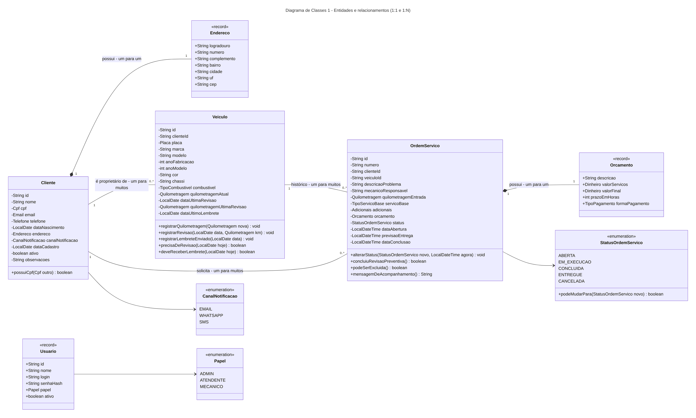
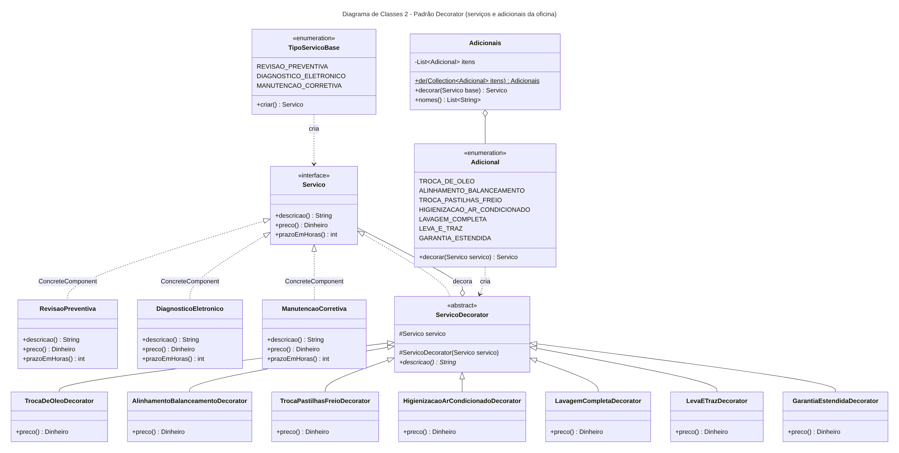
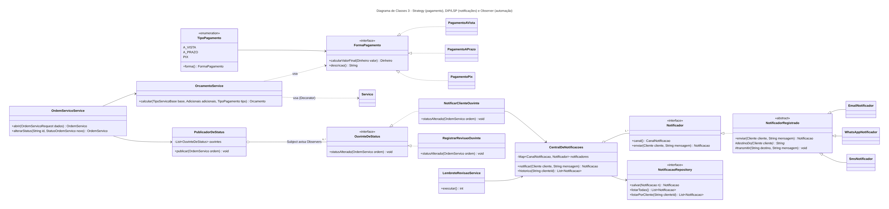
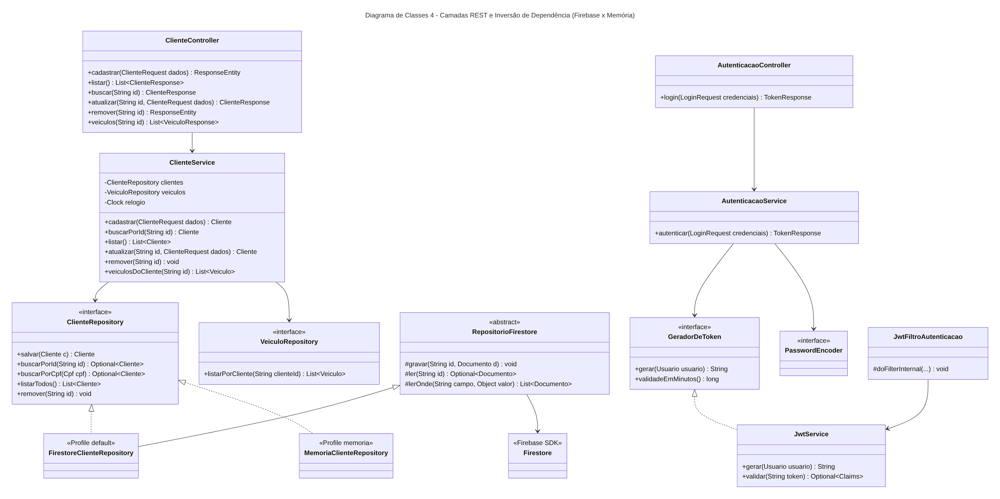
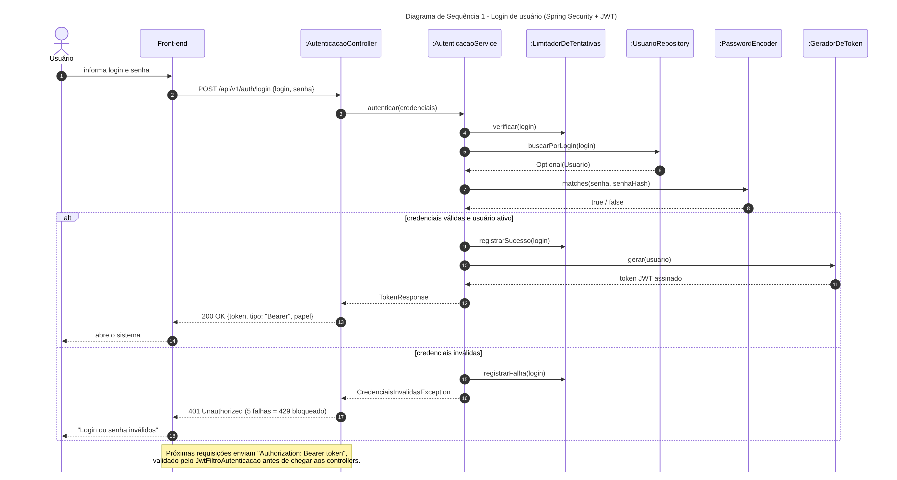
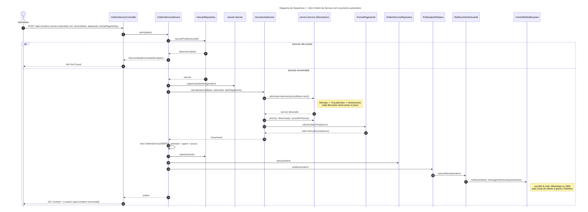
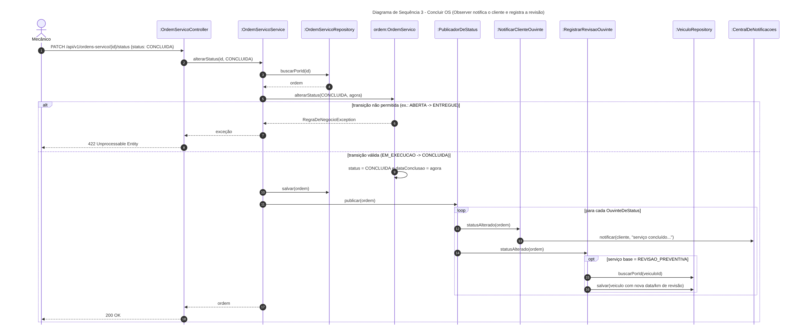
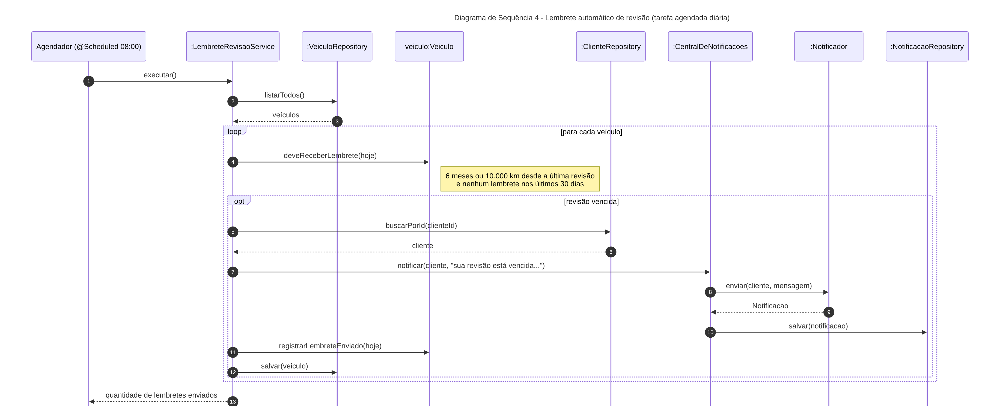

# 🔧 Oficina Mecânica API

> ## 📄 [CLIQUE AQUI PARA VER O RESUMO DO PROJETO EM PDF](Apresentacao-Oficina-Mecanica.pdf)
> O que o aplicativo é, o que ele faz, as automações e as tecnologias usadas, em uma página.

Sistema de gerenciamento de oficina mecânica (clientes, veículos e ordens de serviço) desenvolvido para a avaliação **M2 de Padrões de Projeto** – Engenharia de Software, 5º semestre (UMC).

**Grupo G09:** Iago Sousa Martins · Gustavo Fereira

---

## Sumário
1. [Funcionalidades](#funcionalidades)
2. [Automações](#automações)
3. [Tecnologias](#tecnologias)
4. [Padrões de projeto e princípios](#padrões-de-projeto-e-princípios)
5. [Relacionamentos (1:1 e 1:N)](#relacionamentos-11-e-1n)
6. [Diagramas](#diagramas)
7. [API REST](#api-rest)
8. [Como executar (NetBeans)](#como-executar-netbeans)
9. [Configurar o Firebase](#configurar-o-firebase)
10. [Testes unitários](#testes-unitários)
11. [Segurança](#segurança)
12. [Deploy](#deploy)

---

## Funcionalidades
- **Login de usuário** com perfis `ADMIN`, `ATENDENTE` e `MECANICO` (token JWT).
- **Clientes** – CRUD completo (11 atributos + endereço).
- **Veículos** – CRUD completo (14 atributos), vinculados ao cliente proprietário.
- **Ordens de serviço** – abertura com orçamento automático, ciclo de status (`ABERTA → EM_EXECUCAO → CONCLUIDA → ENTREGUE`, ou `CANCELADA`), histórico por veículo.
- **Simulação de orçamento** e **catálogo** de serviços, adicionais e formas de pagamento.
- **Histórico de notificações** enviadas aos clientes.
- Front-end web simples (`/`) e documentação interativa Swagger (`/swagger-ui.html`).

## Automações
| Automação | Como funciona | Onde está |
|---|---|---|
| **Orçamento automático** | Ao abrir a OS, o serviço base é "decorado" com os adicionais escolhidos (Decorator) e a forma de pagamento aplica desconto/juros (Strategy). A previsão de entrega é calculada pelo prazo somado. | `OrcamentoService`, `OrdemServicoService.abrir` |
| **Notificação ao cliente** | A cada abertura/mudança de status, o cliente recebe mensagem pelo canal preferido (E-mail, WhatsApp ou SMS). | `PublicadorDeStatus` + `NotificarClienteOuvinte` (Observer) |
| **Registro de revisão** | Ao concluir uma revisão preventiva, a data e a quilometragem da última revisão do veículo são atualizadas sozinhas. | `RegistrarRevisaoOuvinte` |
| **Lembrete de revisão** | Tarefa agendada (todo dia às 08:00) avisa os donos de veículos com revisão vencida (6 meses ou 10.000 km), no máximo 1 lembrete a cada 30 dias. | `LembreteRevisaoService` (`@Scheduled`) |

> Os envios são **simulados** (registrados no log e no histórico `/api/v1/notificacoes`). Para enviar de verdade basta trocar o método `transmitir` de cada notificador pela API real (SendGrid, Meta, operadora de SMS) – nenhuma regra de negócio muda (DIP).

## Tecnologias
Java 17 · Spring Boot 3.5 · Spring Security + JWT (jjwt) · **Firebase Cloud Firestore** (NoSQL) · JUnit 5 + Mockito + AssertJ · springdoc-openapi (Swagger) · Maven · Docker · GitHub Actions.

## Padrões de projeto e princípios

### Decorator (sem framework)
Problema evitado: "explosão de subclasses" (Revisão + Óleo, Revisão + Óleo + Alinhamento, ...).

| Papel GoF | Classe(s) |
|---|---|
| Component | `Servico` (interface) |
| ConcreteComponent | `RevisaoPreventiva`, `DiagnosticoEletronico`, `ManutencaoCorretiva` |
| Decorator | `ServicoDecorator` (abstrata, guarda um `Servico` por composição) |
| ConcreteDecorator | `TrocaDeOleoDecorator`, `AlinhamentoBalanceamentoDecorator`, `TrocaPastilhasFreioDecorator`, `HigienizacaoArCondicionadoDecorator`, `LavagemCompletaDecorator`, `LevaETrazDecorator`, `GarantiaEstendidaDecorator` |

```java
Servico servico = new AlinhamentoBalanceamentoDecorator(
                    new TrocaDeOleoDecorator(new RevisaoPreventiva()));
servico.preco();  // 250 + 180 + 120 = R$ 550,00 (montado em tempo de execução)
```
Para um novo adicional basta **uma** classe nova e uma constante no enum `Adicional`.

### Demais padrões
| Padrão | Aplicação |
|---|---|
| **Strategy** | `FormaPagamento` → `PagamentoAVista` (10%/15% de desconto), `PagamentoAPrazo` (+8%), `PagamentoPix` (−5%) |
| **Observer** | `PublicadorDeStatus` (Subject) avisa os `OuvinteDeStatus` (Observers) quando a OS muda |
| **Factory (enum)** | `TipoServicoBase.criar()`, `Adicional.decorar()`, `TipoPagamento.forma()` – sem `if`/`switch` |
| **Template Method** | `NotificadorRegistrado.enviar()` com o passo variável `destinoDo()` |
| **Repository** | Interfaces em `dominio.repositorio` com implementações Firestore e em memória |
| **DTO** | `records` em `api.dto` (entrada e saída da API, sem expor o domínio nem o hash da senha) |

### SOLID
- **S** – cada classe tem um motivo para mudar: controllers só tratam HTTP, services só regras, repositórios só persistência, `TratadorDeErros` só converte exceções.
- **O** – novos serviços, adicionais, formas de pagamento, notificadores ou automações (ouvintes) entram como **classes novas**, sem alterar as existentes.
- **L** – todas as `FormaPagamento`, `Notificador` e `Servico` respeitam o mesmo contrato (nenhuma lança "não suportado", nenhuma exige pré-condição a mais). Há teste parametrizado provando a substituição (`FormaPagamentoTest.contratoDeSubstituicao`).
- **I** – interfaces pequenas e específicas (`GeradorDeToken`, `OuvinteDeStatus`, um repositório por entidade).
- **D** – services dependem de **abstrações** injetadas pelo construtor (`ClienteRepository`, `Notificador`, `GeradorDeToken`, `PasswordEncoder`, `Clock`). Prova prática: o perfil `memoria` troca o Firebase por memória sem mudar uma linha das regras de negócio.

### Calistenia de Objetos
| Regra | Aplicação |
|---|---|
| Um nível de indentação por método | métodos curtos; laços e condições extraídos para métodos privados |
| Não use `else` | retornos antecipados (`PagamentoAVista`, `RegistrarRevisaoOuvinte`) e despacho por enum/mapa |
| Encapsule primitivos e Strings | `Cpf`, `Email`, `Telefone`, `Placa`, `Dinheiro`, `Quilometragem` (com validação própria) |
| Coleções de primeira classe | `Adicionais` |
| Um ponto por linha | navegação encapsulada (`veiculo.descricaoResumida()`, `ordem.mensagemDeAcompanhamento()`) |
| Não abrevie | nomes completos em português |
| Entidades pequenas | regras distribuídas em objetos de valor, enums e serviços |
| Sem getters/setters | **nenhum setter**: estado muda só por métodos de negócio (`alterarStatus`, `registrarRevisao`); leitura por métodos no estilo record |
| No máximo duas variáveis de instância | aplicada nos objetos de valor; nas entidades foi flexibilizada porque a especificação exige ≥ 10 atributos |

## Relacionamentos (1:1 e 1:N)
| Relacionamento | Tipo | Implementação |
|---|---|---|
| Cliente — Endereço | **1:1** (composição) | `Cliente.endereco`; no Firestore fica embutido no documento do cliente |
| Ordem de Serviço — Orçamento | **1:1** (composição) | `OrdemServico.orcamento`; embutido no documento da OS |
| Cliente — Veículos | **1:N** | `Veiculo.clienteId` → `GET /api/v1/clientes/{id}/veiculos` |
| Veículo — Ordens de Serviço | **1:N** | `OrdemServico.veiculoId` → `GET /api/v1/veiculos/{id}/ordens-servico` |

Regras de integridade: não se cadastra veículo sem cliente existente (404); não se exclui cliente com veículos nem veículo com OS (409).

## Diagramas
Fontes Mermaid e imagens em [`docs/diagramas`](docs/diagramas).

**Classes**





**Sequência**





## API REST
Base: `/api/v1` · JSON · recursos no plural · verbos HTTP semânticos · erros no padrão **RFC 7807 (Problem Details)**.

| Método | Rota | Descrição | Sucesso |
|---|---|---|---|
| POST | `/auth/login` | Login (público) | 200 |
| POST / GET | `/usuarios` | Cadastrar / listar usuários (ADMIN) | 201 / 200 |
| POST / GET | `/clientes` | Cadastrar / listar | 201 / 200 |
| GET / PUT / DELETE | `/clientes/{id}` | Buscar / atualizar / remover | 200 / 200 / 204 |
| GET | `/clientes/{id}/veiculos` | Veículos do cliente (1:N) | 200 |
| POST / GET | `/veiculos` | Cadastrar / listar | 201 / 200 |
| GET / PUT / DELETE | `/veiculos/{id}` | Buscar / atualizar / remover | 200 / 200 / 204 |
| GET | `/veiculos/{id}/ordens-servico` | Histórico do veículo (1:N) | 200 |
| POST / GET | `/ordens-servico` (`?status=`) | Abrir / listar | 201 / 200 |
| GET / DELETE | `/ordens-servico/{id}` | Buscar / remover | 200 / 204 |
| PATCH | `/ordens-servico/{id}/status` | Alterar status | 200 |
| POST | `/orcamentos/simulacoes` | Simular orçamento | 200 |
| GET | `/catalogo` | Serviços, adicionais, pagamentos | 200 |
| GET | `/notificacoes` (`?clienteId=`) | Histórico de notificações | 200 |
| POST | `/lembretes-revisao/execucoes` | Executa a rotina de lembretes agora | 200 |

Códigos de erro: `400` dados inválidos · `401` sem login/credenciais inválidas · `403` perfil sem permissão · `404` não encontrado · `409` conflito (CPF/placa duplicados, exclusão bloqueada) · `422` regra de negócio · `429` login bloqueado.

Exemplo – abrir OS:
```http
POST /api/v1/ordens-servico
Authorization: Bearer <token>
Content-Type: application/json

{
  "veiculoId": "…",
  "descricaoProblema": "Barulho ao frear",
  "mecanicoResponsavel": "João",
  "quilometragemEntrada": 60000,
  "servicoBase": "REVISAO_PREVENTIVA",
  "adicionais": ["TROCA_DE_OLEO", "ALINHAMENTO_BALANCEAMENTO"],
  "formaPagamento": "PIX"
}
```
Resposta `201 Created` + cabeçalho `Location`, com orçamento de **R$ 522,50** (550 − 5% PIX).

## Como executar (NetBeans)
Pré-requisitos: **JDK 17+** e NetBeans com suporte a Maven (já vem por padrão).

1. `File > Open Project` e selecione a pasta `oficina-mecanica-api` (o NetBeans reconhece o `pom.xml`).
2. Na primeira vez, clique com o botão direito no projeto → **Build with Dependencies** (baixa as bibliotecas).
3. Configure o Firebase (próxima seção).
4. **Run Project (F6)** – sobe em `http://localhost:8081`.
   - Sem Firebase/sem internet: botão direito → **Run Maven → Rodar sem Firebase (perfil memoria)**.
5. Acesse `http://localhost:8081` (tela do sistema) ou `http://localhost:8081/swagger-ui.html`.
6. Login inicial: **`admin` / `admin123`** (troque pela variável `ADMIN_SENHA`).

Na primeira execução são criados dados de demonstração: a cliente *Maria da Silva* e o veículo *BRA2E19* com revisão vencida – clique em **Notificações → Executar rotina de lembretes** para ver a automação.

Linha de comando: `mvn spring-boot:run` ou `mvn spring-boot:run -Dspring-boot.run.profiles=memoria`.

## Configurar o Firebase
1. Em <https://console.firebase.google.com> crie um projeto.
2. **Build → Firestore Database → Criar banco de dados** (modo produção, região `southamerica-east1`).
3. **Configurações do projeto → Contas de serviço → Gerar nova chave privada**. Salve o arquivo como `firebase-credenciais.json` na raiz do projeto (ele está no `.gitignore` – **nunca suba para o GitHub**).
4. Em `application.properties`, coloque o ID do projeto em `firebase.project-id` (ou use a variável `FIREBASE_PROJECT_ID`).

Coleções criadas: `clientes`, `veiculos`, `ordens_servico`, `usuarios`, `notificacoes`.

## Testes unitários
```bash
mvn test        # ou, no NetBeans: botão direito → Test (Alt+F6)
```
- **76 testes** com JUnit 5, Mockito e AssertJ, todos no padrão **AAA** (Arrange, Act, Assert).
- Para **cada método de cada service** há cenário **positivo** e **negativo**.
- Repositórios simulados com **Mockito** (opção 3 da aula) – os testes não precisam do Firebase.
- `Clock` fixo para datas previsíveis.

| Classe de teste | O que cobre |
|---|---|
| `DecoratorServicoTest` | empilhamento de decoradores, garantia sobre o total, adicionais repetidos |
| `FormaPagamentoTest` | faixas de desconto/juros e **teste de LSP** parametrizado |
| `ObjetosDeValorTest`, `EntidadesTest` | CPF, placa, dinheiro, ciclo da OS, regras de revisão |
| `ClienteServiceTest`, `VeiculoServiceTest`, `OrdemServicoServiceTest`, `OrcamentoServiceTest` | regras de negócio e relacionamentos |
| `NotificacoesEObservadoresTest`, `LembreteRevisaoServiceTest` | automações (Observer, notificações, agendamento) |
| `AutenticacaoEUsuarioServiceTest` | login, usuário inativo, bloqueio por força bruta, hash de senha |

## Segurança
- **Spring Security** stateless com **JWT** assinado (HMAC-SHA256) e expiração configurável.
- Senhas com **BCrypt**; o hash nunca sai na API.
- **Autorização por perfil**: só `ADMIN` gerencia usuários e exclui registros.
- **Proteção contra força bruta**: 5 senhas erradas bloqueiam o login por 5 minutos (`429`).
- Mensagem de erro de login genérica (não revela se o usuário existe).
- Validação de entrada (Bean Validation + objetos de valor) e erros sem *stack trace*.
- Cabeçalhos de segurança (`X-Frame-Options: DENY`, etc.), CORS restrito.
- Segredos (JWT, credenciais Firebase, senha admin) somente por **variáveis de ambiente**; front-end usa `textContent` (evita XSS).

## Deploy
- **Dockerfile** multi-estágio (compila + testa, imagem final só com JRE e usuário sem privilégios).
- **GitHub Actions** (`.github/workflows/ci.yml`) roda os testes a cada push.
- Exemplo no **Render** (gratuito): *New → Web Service → conectar o repositório → Docker*. Variáveis:
  `FIREBASE_PROJECT_ID`, `FIREBASE_CREDENTIALS_JSON` (conteúdo do JSON), `JWT_SEGREDO` (≥ 32 caracteres), `ADMIN_SENHA`, `CORS_ORIGENS`.

## Estrutura
```
src/main/java/br/umc/oficina
├── api            controllers REST, DTOs (records) e tratador de erros
├── aplicacao      services (regras de negócio, automações, Observer)
├── dominio        entidades, objetos de valor, Decorator, Strategy, interfaces de repositório
├── infra          Firebase, repositórios em memória, notificadores, configurações
└── seguranca      Spring Security + JWT
```
